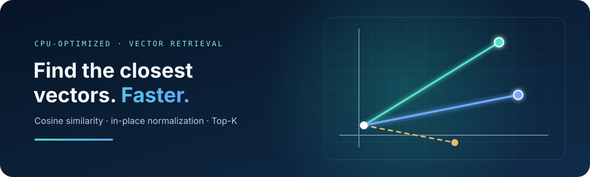

# cpu-vector-8X-search-engine

A CPU-focused vector search demo for RAG and recommendation workflows, exploring optimized embedding normalization and cosine-similarity retrieval with NumPy and Numba.
